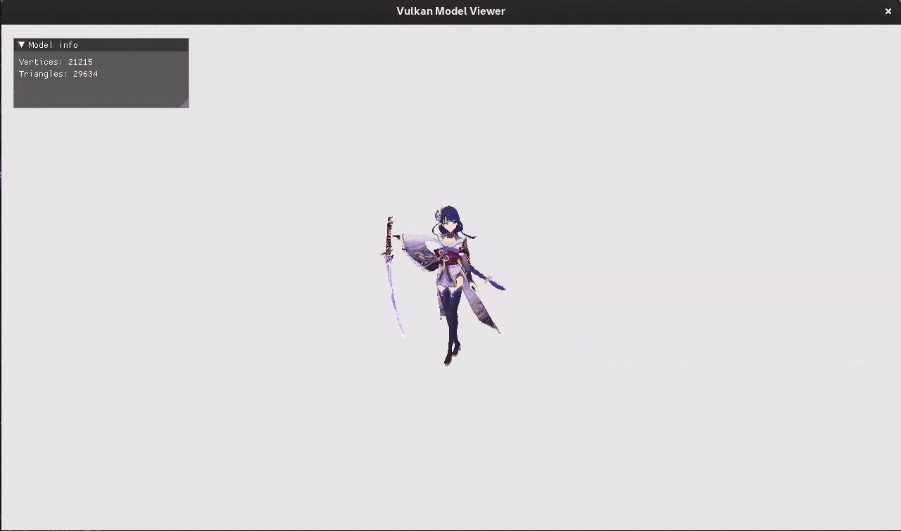

# VulkanModelViewer

[英語版 (English)](./README.md)

## 概要
本プロジェクトでは、C++とVulkanを使用して3Dモデルビューアを作ってみました。ウィンドウへのドラッグ＆ドロップでモデルファイルを直接読み込み、オービットカメラによる視点操作やリアルタイムのメッシュ統計情報を確認できます。


## 機能
1. 3Dモデルの読み込みと自動スケーリング
   - ウィンドウへのドラッグ＆ドロップ操作による3Dモデル（OBJ、glTF）の読み込み。
   - ノード階層、頂点座標、インデックス、テクスチャ座標データの解析と取得。
   - 読み込んだモデルがカメラ視野内に収まるよう自動スケーリング。
2. Vulkanによる描画処理
   - アプリケーションの描画バックエンドとしてVulkanを採用。
3. テクスチャマッピングとマテリアル
   - サブメッシュごとのディフューズおよびエミッシブテクスチャのバインド（合成イメージサンプラー対応）。
   - テクスチャが存在しないモデルに対する1x1デフォルトテクスチャのフォールバック適用。
4. オービットカメラ操作
   - 注視点を中心とした球面オービット回転、およびキーボード操作によるカメラの平行移動に対応。

## 操作方法
| 入力 | アクション |
| :--- | :--- |
| **右クリック + ドラッグ** | カメラの視点回転（ヨー / ピッチ） |
| **W / S** | カメラ注視点の前進 / 後退 |
| **A / D** | カメラ注視点の左右平行移動 |
| **ドラッグ＆ドロップ** | 3Dモデルファイルをウィンドウにドロップして読み込み |

## 技術スタックと依存関係
- **言語**: C++20
- **グラフィックスAPI**: Vulkan (1.2+)
- **ウィンドウ / 入力**: [GLFW](https://www.glfw.org/) (3.4)
- **3Dアセット読み込み**: [Assimp](https://github.com/assimp/assimp) (Open Asset Import Library)
- **数学ライブラリ**: [GLM](https://github.com/g-truc/glm) (OpenGL Mathematics)
- **画像読み込み**: [stb_image](https://github.com/nothings/stb)
- **ユーザーインターフェース**: [Dear ImGui](https://github.com/ocornut/imgui)
- **シェーダーコンパイラ**: `glslangValidator` (Vulkan SDKに付属)
- **ビルドシステム**: CMake (3.10+)

## プロジェクト構成

```text
|-- include/
|   |-- Graphics/
|   |   |-- Vulkan/
|   |   |   |-- VulkanBuffer.hpp      # 頂点・インデックス・ユニフォーム用GPUバッファラッパー
|   |   |   |-- VulkanContext.hpp     # Vulkanインスタンス、デバイス、キュー、サーフェス管理
|   |   |   |-- VulkanImage.hpp       # Vulkan画像およびメモリ確保ラッパー
|   |   |   |-- VulkanImageView.hpp   # Vulkan画像ビューの抽象化
|   |   |-- Camera.hpp                # カメラのビュー・射影行列計算
|   |   |-- Mesh.hpp                  # メッシュの頂点・インデックス・テクスチャパス定義
|   |   |-- Model.hpp                 # Assimpモデルローダーおよびノード階層解析
|   |   |-- OrbitCamera.hpp           # 球面オービットカメラコントローラー
|   |   |-- Renderer.hpp              # パイプライン、記述子、描画バッチ処理
|   |   |-- Vertex.hpp                # 頂点レイアウト定義（座標、頂点カラー、UV）
|   |-- IO/
|   |   |-- FileIO.hpp                # バイナリファイル読み込みユーティリティ
|   |-- Input/
|   |   |-- Input.hpp                 # GLFW入力ポーリングおよびマウス追従シングルトン
|   |-- Application.hpp               # アプリケーションループ、スワップチェーン、イベント管理
|-- src/
|   |-- Graphics/
|   |   |-- Vulkan/                   # Vulkanリソースラッパーの実装
|   |   |-- Camera.cpp                # 射影行列およびビュー行列計算の実装
|   |   |-- Model.cpp                 # シーン走査、メッシュ変換、テクスチャパス解決
|   |   |-- OrbitCamera.cpp           # 注視点追従と球面回転計算の実装
|   |   |-- Renderer.cpp              # パイプライン生成、バッファステージング、描画処理
|   |-- IO/
|   |   |-- FileIO.cpp                # ファイル読み込み処理の実装
|   |-- Input/
|   |   |-- Input.cpp                 # キーボード・マウス状態のポーリング実装
|   |-- Application.cpp               # ウィンドウ生成、描画ループ、ImGui統合、D&D処理
|   |-- Main.cpp                      # エントリーポイント
|-- resources/
|   |-- shaders/                      # GLSL頂点／フラグメントシェーダーおよびSPIR-Vバイナリ
|   |-- textures/                     # 1x1ディフューズ／エミッシブ用フォールバックテクスチャ
|-- deps/                             # 外部サードパーティライブラリ（GLM, STB, Dear ImGui）
|-- CMakeLists.txt                    # GLFW・AssimpをFetchContentで取得するCMake設定
|-- build.bat                         # MinGW Makefilesを使用したWindows用ビルドスクリプト
```

## ビルドと実行

### 前提条件
- CMake 3.10 以上
- C++20 対応コンパイラ（GCC 10+、Clang 11+、または MSVC 2019+）
- Vulkan SDK（ヘッダー、ローダー、および `glslangValidator` を含む）
- Git（CMakeの `FetchContent` でGLFWとAssimpをダウンロードするために必要）

#### Fedora の場合:
```bash
sudo dnf install -y gcc-c++ cmake git vulkan-loader-devel vulkan-tools glslang
```

#### Ubuntu / Debian の場合:
```bash
sudo apt update && sudo apt install -y build-essential cmake git libvulkan-dev vulkan-tools glslang-tools libx11-xcb-dev libxkbcommon-dev libwayland-dev libxrandr-dev libxinerama-dev libxcursor-dev libxi-dev
```

### ビルド手順

#### Linux / macOS / WSL の場合:
```bash
cmake -B build -S . -DCMAKE_BUILD_TYPE=Release
cmake --build build --parallel
cd build
./VulkanModelViewer
```

#### Windows (CMake & Visual Studio / MinGW) の場合:
`build.bat` を使用する場合（MinGW）:
```cmd
build.bat
cd build
VulkanModelViewer.exe
```

Visual Studio で直接 CMake を使用する場合:
```cmd
cmake -B build -S .
cmake --build build --config Release
cd build/Release
VulkanModelViewer.exe
```
